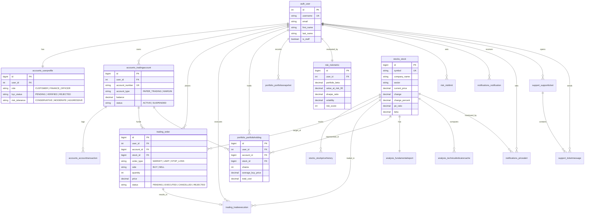

# PortfolioPro - Entity Relationship (ER) Diagram & Data Model
**Deliverable D03 (Sprint 0 - Epic P15-E01 / US02)**

## 1. Database Architecture Overview
The database schema for **PortfolioPro** is normalized to 3NF (Third Normal Form) and implemented for **MySQL 8.0** with strict transactional integrity (InnoDB engine, foreign keys, cascade deletes, and indexing on frequent lookup fields such as `symbol`, `sector`, `date`, `user_id`).

---

## 2. Mermaid Entity Relationship (ER) Diagram

---

## 3. Normalized Relational Table Summary

| Table Name | Primary Key | Foreign Keys | Purpose |
|---|---|---|---|
| `auth_user` | `id` | None | Django core user authentication table |
| `accounts_userprofile` | `id` | `user_id` -> `auth_user(id)` | User role (Customer, Finance Officer), KYC, contact details |
| `accounts_tradingaccount` | `id` | `user_id` -> `auth_user(id)` | Paper trading account balance, type, account number |
| `accounts_accounttransaction` | `id` | `account_id` -> `accounts_tradingaccount(id)` | Ledger of deposits, withdrawals, trade debits and credits |
| `stocks_stock` | `id` | None | Equities master catalog, current quotes, volume, market cap |
| `stocks_stockpricehistory` | `id` | `stock_id` -> `stocks_stock(id)` | Daily OHLCV price series for interactive charting |
| `stocks_watchlist` | `id` | `user_id` -> `auth_user(id)` | Saved user stock watchlists |
| `trading_order` | `id` | `user_id`, `account_id`, `stock_id` | Buy/Sell orders (Market, Limit, Stop-Loss) with life-cycle state |
| `trading_tradeexecution` | `id` | `order_id`, `user_id`, `stock_id` | Trade fill audit log with execution ID and timestamp |
| `portfolio_portfolioholding` | `id` | `user_id`, `account_id`, `stock_id` | Current position size, average entry price, total invested capital |
| `portfolio_portfoliosnapshot` | `id` | `user_id` -> `auth_user(id)` | Daily portfolio equity snapshots for historical performance curves |
| `risk_riskmetric` | `id` | `user_id` -> `auth_user(id)` | 95% VaR, Beta, Sharpe ratio, Volatility %, Composite Risk Score |
| `risk_risklimit` | `id` | `user_id` -> `auth_user(id)` | Risk controls: max position size %, stop-loss alert % |
| `analysis_fundamentalreport` | `id` | `stock_id` -> `stocks_stock(id)` | Annual income, balance sheet, ROE, debt-to-equity, summary |
| `analysis_technicalindicatorcache` | `id` | `stock_id` -> `stocks_stock(id)` | SMA-20, SMA-50, EMA-20, RSI-14, MACD, Bollinger Bands, signals |
| `notifications_notification` | `id` | `user_id` -> `auth_user(id)` | In-app alerts: trade executions, price movements, system events |
| `notifications_pricealert` | `id` | `user_id`, `stock_id` | User price trigger conditions (Crosses Above, Falls Below) |
| `support_supportticket` | `id` | `user_id` -> `auth_user(id)` | Customer service tickets with category, priority, and workflow status |
| `support_ticketmessage` | `id` | `ticket_id`, `sender_id` | Conversation thread between customer and finance/support officers |
