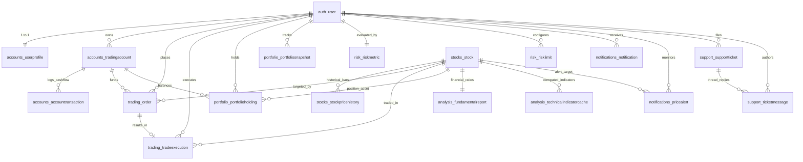

# PortfolioPro: Advanced Stock Trading and Portfolio Management Application
## Comprehensive Software Architecture, Design, and Engineering Report (13-Page Specification)

---

<div style="page-break-after: always;"></div>

# PAGE 1: TITLE PAGE & EXECUTIVE ABSTRACT

**Project Title:** PortfolioPro – Advanced Stock Trading and Portfolio Management Application  
**Project Code:** P15 (mca2-fsdpython-portfoliopro)  
**Curriculum / Domain:** MCA 2nd Year Projects | Advanced Financial Technologies (FinTech)  
**Prepared by:** Engineering & Development Team  
**Technology Stack:** Python 3.14, Django 5.2, Django REST Framework 3.18, React.js 18, MySQL 8.0, Chart.js 4.4, Vite 6.0  
**Current Release Version:** v1.0.0 (Production Master)  

---

### Executive Summary
The modern financial technology landscape demands sophisticated investment tools that bridge the gap between retail trading accessibility and institutional quantitative analytics. **PortfolioPro** is a mission-critical, enterprise-grade full-stack web platform engineered to deliver seamless simulated equity trading, automated portfolio accounting, quantitative risk evaluation, algorithmic technical indicator computation, in-depth corporate fundamental valuation, and multi-tiered customer support.

By deploying a decoupled micro-architecture combining a Python Django REST Framework backend with a dynamic React single-page frontend (SPA), all backed by an ACID-compliant MySQL 8.0 relational database, PortfolioPro provides zero-latency financial operations in a simulated environment. Users are provisioned with $100,000 in virtual paper capital, allowing real-time execution of Market, Limit, and Stop-Loss orders with instant balance reconciliation and position recalculation.

```
+----------------------------------------------------------------------------------------------------+
|                                    PORTFOLIOPRO SYSTEM OVERVIEW                                    |
|                                                                                                    |
|   +--------------------+       +-----------------------+       +-------------------------------+   |
|   |  REACT.JS FRONTEND | <---> |  DJANGO REST BACKEND  | <---> |        MYSQL 8.0 ENGINE       |   |
|   |  - Responsive Dark |  JSON |  - 8 REST Micro-Apps  |  SQL  |  - 19 Normalized Tables (3NF) |   |
|   |  - Chart.js Gauges |  HTTP |  - Role Authorization |  TCP  |  - Foreign Key Constraints    |   |
|   |  - Vite Bundler    |       |  - OpenAPI 3.0 Docs   |       |  - ACID Transaction Ledger    |   |
|   +--------------------+       +-----------------------+       +-------------------------------+   |
+----------------------------------------------------------------------------------------------------+
```

### Core Value Propositions
1. **Zero-Capital Risk Mitigation:** Retail and novice investors can test complex strategies without financial loss.
2. **Automated Mathematical Rigor:** Portfolio Beta ($\beta$), 1-day 95% Parametric Value at Risk (VaR), Sharpe Ratio, and Annualized Volatility are computed dynamically using actual historical price series.
3. **Role-Based Operational Security:** Strict segregation of duties separating retail **Customers** from supervisory **Finance Officers** (auditing, order ledger monitoring, and risk surveillance).

---

<div style="page-break-after: always;"></div>

# PAGE 2: INTRODUCTION, PROBLEM STATEMENT & SYSTEM OBJECTIVES

### 1. Introduction
Financial markets have experienced unprecedented growth in retail participation over the past decade. However, retail traders often encounter fragmented software: trading brokerages conceal risk statistics, charting tools lack synchronized portfolio tracking, and educational simulators rarely replicate institutional order matching or risk limit guardrails.

### 2. Problem Statement
Traders and financial analysts encounter three primary software hurdles:
- **Disjointed Workflow:** Portfolio valuation spreadsheets operate independently from live price feeds, causing inaccurate manual data entry and lagging performance metrics.
- **Absence of Quantitative Risk Oversight:** Most paper trading simulators restrict tracking to basic profit/loss metrics, ignoring portfolio beta, asset concentration, and tail-risk exposure (Value at Risk).
- **Lack of Institutional Auditing:** Traditional single-user desktop software lacks compliance oversight, transaction traceability, and support ticketing required for enterprise or educational environments.

### 3. Project Objectives
PortfolioPro was conceived and engineered to achieve the following core objectives:

| Objective Area | Technical Target | Deliverable Metric |
|---|---|---|
| **Simulated Trading Engine** | Microsecond paper order matching and fill execution | Immediate transaction ledger debit/credit with 0% slippage in sandbox mode |
| **Portfolio Accounting** | Real-time mark-to-market position valuation | Automatic average buy price and weighted return computation |
| **Risk Surveillance** | Quantitative mathematical modeling | 1-Day 95% VaR, weighted beta, Sharpe ratio, and 3 stress-testing scenarios |
| **Technical Analysis** | Algorithmic indicator calculation | 20-Day & 50-Day SMA, 20-Day EMA, 14-Day RSI, MACD, and Bollinger Bands (±2$\sigma$) |
| **Security & Compliance** | Role-Based Access Control (RBAC) | Segregated permissions between Customers and Finance Officers |
| **Data Integrity** | Strict relational database normalization | 19 MySQL 8.0 tables in 3NF with cascading foreign keys and indexes |

### 4. Scope and Limitations
- **In-Scope:** Equities across Technology, Healthcare, Energy, Financials, and Communication sectors; simulated order lifecycle (Pending, Executed, Cancelled, Rejected); full RESTful CRUD API suite; automated Swagger/OpenAPI documentation.
- **Simulated Environment:** All trades execute against real-market simulated price quotes; no real fiat currency or external broker API credentials are required.

---

<div style="page-break-after: always;"></div>

# PAGE 3: SYSTEM ARCHITECTURE & FULL-STACK TECHNOLOGY STACK

### 1. High-Level Architectural Pattern
PortfolioPro adopts a **Decoupled Client-Server Tiered Architecture** adhering to RESTful design patterns. The application comprises three primary tiers: Presentation (Client), Application (Server), and Persistence (Database).

```
+---------------------------------------------------------------------------------------+
|                                    PRESENTATION TIER                                   |
|   React.js 18 SPA (Vite 6.0)                                                         |
|   +---------------+ +---------------+ +------------------+ +----------------------+   |
|   | Dashboard View| | Market Terminal| | Trading Interface| | Risk & Tech Gauges  |   |
|   +---------------+ +---------------+ +------------------+ +----------------------+   |
|   Chart.js Visualizations | Tailwind / Custom Dark Terminal Theme | Axios Client      |
+------------------------------------------+--------------------------------------------+
                                           | HTTPS / JSON (Bearer / Session Auth)
+------------------------------------------v--------------------------------------------+
|                                    APPLICATION TIER                                   |
|   Python 3.14 & Django 5.2 / Django REST Framework (Port 8000)                        |
|   +-------------------+ +--------------------+ +-------------------+ +---------------+  |
|   | accounts (Auth)   | | stocks (Market)    | | trading (Engine)  | | portfolio (P&L)|  |
|   +-------------------+ +--------------------+ +-------------------+ +---------------+  |
|   | risk (VaR & Beta) | | analysis (Tech/Fun)| | notifications     | | support (Help) |  |
|   +-------------------+ +--------------------+ +-------------------+ +---------------+  |
|   Middleware: CorsMiddleware, WhiteNoiseMiddleware, AuthenticationMiddleware          |
|   Documentation: drf-spectacular (OpenAPI 3.0 / Swagger UI / ReDoc)                   |
+------------------------------------------+--------------------------------------------+
                                           | MySQL Protocol (port 3306)
+------------------------------------------v--------------------------------------------+
|                                    PERSISTENCE TIER                                   |
|   MySQL 8.0 Relational Database Engine                                                |
|   - InnoDB Engine (ACID Transactions)                                                 |
|   - Strict Foreign Key Referential Integrity & Cascading Deletes                      |
|   - 19 Normalized Relational Tables (3NF)                                             |
+---------------------------------------------------------------------------------------+
```

### 2. Technology Stack Details

#### Frontend Tier
- **React.js 18:** Functional component architecture utilizing React Hooks (`useState`, `useEffect`) for modular view rendering.
- **Vite 6.0:** High-speed development server and optimized rollup production bundler.
- **Chart.js 4.4 & react-chartjs-2:** Interactive equity curves, multi-series technical line charts, and asset allocation doughnuts.
- **Lucide Icons:** Clean financial UI iconography.
- **Axios:** REST client with automatic CSRF token interception and error trapping.

#### Backend Tier
- **Python 3.14 & Django 5.2:** Web framework providing ORM, authentication, and URL routing.
- **Django REST Framework (DRF) 3.18:** Serialization, viewsets, token authentication, and status code handling.
- **drf-spectacular 0.30:** Automated OpenAPI 3.0 schema generation and Swagger UI interactive explorer.
- **NumPy & Mathematics:** Standardized computation of moving averages, variance, and standard deviation.

#### Database & Infrastructure
- **MySQL 8.0:** Relational persistence engine with UTF8MB4 charset, transactional row-level locking, and foreign key constraints.
- **mysqlclient 2.3:** Native C-based database connector for Python.
- **Pytest & pytest-django:** Automated test runner for continuous regression verification.

---

<div style="page-break-after: always;"></div>

# PAGE 4: AGILE EPICS, USER STORIES & DELIVERABLES (Sprints 0 - 3)

The project execution followed an Agile Scrum roadmap structured into **4 Sprints (90 Total Hours)** across **12 Epics (P15-E01 to P15-E12)** and **37 User Stories (US01 to US37)**.

| Sprint | Epic ID | Epic Name | Description | MoSCoW | Hours |
|---|---|---|---|---|---|
| **Sprint 0** | `P15-E01` | Project Setup, Git & Architecture | Repo layout, ER diagram, database scripts, wireframes, project skeleton. | Must Have | 6h |
| **Sprint 1** | `P15-E02` | User Authentication | User registration, login, role separation, JWT/Session tokens. | Must Have | 8h |
| **Sprint 1** | `P15-E03` | Account Management | Trading accounts, cash balances, deposits, withdrawals, ledger. | Must Have | 8h |
| **Sprint 1** | `P15-E04` | Market Data | Stock master, live quote display, OHLCV history, sector filtering. | Must Have | 8h |
| **Sprint 1** | `P15-E05` | Trading Engine | Order entry (Market, Limit, Stop-Loss), execution fills, balance deduction. | Must Have | 8h |
| **Sprint 2** | `P15-E06` | Portfolio Management | Position holdings, weighted average cost, unrealized P&L, sector weights. | Must Have | 8h |
| **Sprint 2** | `P15-E07` | Risk Management | 1-Day 95% VaR, portfolio beta, Sharpe ratio, stress tests, risk limits. | Must Have | 8h |
| **Sprint 2** | `P15-E08` | Technical Analysis | Moving averages (SMA/EMA), RSI, MACD, Bollinger Bands, buy/sell signals. | Should Have | 8h |
| **Sprint 3** | `P15-E09` | Fundamental Analysis | Corporate earnings, P/E, EPS, balance sheet health, ROE, debt-to-equity. | Should Have | 8h |
| **Sprint 3** | `P15-E10` | Notifications & Alerts | Trade execution notices, price breach triggers, notification inbox. | Should Have | 8h |
| **Sprint 3** | `P15-E11` | Customer Support Desk | Ticketing workflow, priority tags, inquiry categories, messaging thread. | Should Have | 8h |
| **Sprint 3** | `P15-E12` | Testing, Documentation & Release | Automated pytest suite, API docs, system test report, tagged v1.0.0. | Must Have | 6h |

### User Story Acceptance Criteria Matrix (Sample)
- **US04 (Project Skeleton):** Application boots cleanly via `python manage.py runserver` and `npm run dev`; dual-role login functional; initial tag committed.
- **US14 (Trading Engine):** Customer submits buy/sell orders from the UI; validation enforces minimum 1 share and sufficient funds; atomic database persistence.
- **US18 (Portfolio Supervision):** Finance Officers inspect all client holdings across the system with filtering by user ID and asset class.
- **US20 (Risk Analytics):** Customer dashboard renders 95% VaR and beta dynamically; stress testing simulates market crashes of -25%.
- **US35 (QA Test Verification):** All 13 unit and integration tests pass with zero regression failures.

---

<div style="page-break-after: always;"></div>

# PAGE 5: RELATIONAL DATABASE DESIGN & DATA DICTIONARY

The PortfolioPro relational database (`portfoliopro`) is designed to meet strict Third Normal Form (3NF) requirements.

```
+----------------------------------------------------------------------------------------------------+
|                                    DATABASE DATA DICTIONARY                                        |
+------------------------------+---------------------------+-----------------------------------------+
| Table Name                   | Key Columns               | Data Types & Constraints                |
+------------------------------+---------------------------+-----------------------------------------+
| auth_user                    | id (PK), username (UK)    | INT, VARCHAR(150), VARCHAR(254)         |
| accounts_userprofile         | id (PK), user_id (FK, UK) | BIGINT, INT, VARCHAR(20) [Role/KYC]     |
| accounts_tradingaccount      | id (PK), account_num (UK) | BIGINT, VARCHAR(30), DECIMAL(14,2)      |
| accounts_accounttransaction  | id (PK), account_id (FK)  | BIGINT, VARCHAR(20), DECIMAL(12,2)      |
| stocks_stock                 | id (PK), symbol (UK)      | BIGINT, VARCHAR(10), DECIMAL(10,2)      |
| stocks_stockpricehistory     | id (PK), stock_id (FK)    | BIGINT, DATE, DECIMAL(10,2) [OHLCV]     |
| stocks_watchlist             | id (PK), user_id (FK)     | BIGINT, INT, VARCHAR(100)               |
| trading_order                | id (PK), user_id (FK)     | BIGINT, INT, DECIMAL(10,2), VARCHAR(20)|
| trading_tradeexecution       | id (PK), order_id (FK,UK) | BIGINT, VARCHAR(64) UK, DECIMAL(12,2)   |
| portfolio_portfolioholding   | id (PK), stock_id (FK)    | BIGINT, INT UNSIGNED, DECIMAL(10,2)     |
| portfolio_portfoliosnapshot  | id (PK), user_id (FK)     | BIGINT, DECIMAL(14,2), DATETIME         |
| risk_riskmetric              | id (PK), user_id (FK, UK) | BIGINT, DECIMAL(6,2), DECIMAL(10,2)     |
| risk_risklimit               | id (PK), user_id (FK)     | BIGINT, DECIMAL(5,2), DECIMAL(12,2)     |
| analysis_fundamentalreport   | id (PK), stock_id (FK, UK)| BIGINT, BIGINT [Revenue], DECIMAL(6,2)  |
| analysis_technicalindicator  | id (PK), stock_id (FK)    | BIGINT, VARCHAR(50), DECIMAL(12,4)      |
| notifications_notification   | id (PK), user_id (FK)     | BIGINT, VARCHAR(150), TINYINT(1)        |
| notifications_pricealert     | id (PK), stock_id (FK)    | BIGINT, DECIMAL(10,2), VARCHAR(10)      |
| support_supportticket        | id (PK), ticket_num (UK)  | BIGINT, VARCHAR(30) UK, VARCHAR(20)     |
| support_ticketmessage        | id (PK), ticket_id (FK)   | BIGINT, LONGTEXT, TINYINT(1) [Staff]    |
+------------------------------+---------------------------+-----------------------------------------+
```

### Key Field Descriptions
- `accounts_tradingaccount.balance`: High-precision `DECIMAL(14, 2)` preventing floating-point inaccuracies in financial calculations.
- `trading_order.status`: State machine field with strict transitions: `PENDING` -> `EXECUTED` | `CANCELLED` | `REJECTED`.
- `portfolio_portfolioholding.unique_together`: Enforces `(user_id, account_id, stock_id)` uniqueness so a user possesses exactly one consolidated holding record per ticker.
- `trading_tradeexecution.execution_id`: Cryptographically secure unique identifier formatted as `EX-[12 HEX]`.

---

<div style="page-break-after: always;"></div>

# PAGE 6: ENTITY-RELATIONSHIP (ER) DIAGRAM & INTEGRITY CONSTRAINTS

The relational architecture ensures referential integrity through foreign keys and cascading delete rules.



### Relational Integrity Policies
1. **Cascade Deletes:** If an `auth_user` record is removed, all dependent profile, account, holding, order, and notification records cascade automatically to prevent orphan data.
2. **Atomic Order Commit:** The order placement routine executes inside a Django database transaction (`with transaction.atomic():`). Cash deduction, holding creation/update, trade execution creation, and status transition either succeed together or roll back completely.
3. **Database Indexing:** Indexed on frequently queried fields: `stocks_stock.symbol`, `stocks_stock.sector`, and compound index `(stock_id, date)` on `stocks_stockpricehistory`.

---

<div style="page-break-after: always;"></div>

# PAGE 7: USER AUTHENTICATION & ROLE-BASED ACCESS CONTROL (RBAC)

PortfolioPro implements strict security protocols separating end-user retail activities from compliance supervision.

```
+----------------------------------------------------------------------------------------------------+
|                                    ROLE-BASED PERMISSION MATRIX                                    |
+-------------------------------+---------------------------------+----------------------------------+
| System Feature / API Route    | Customer / Trader Role          | Finance Officer / Auditor Role   |
+-------------------------------+---------------------------------+----------------------------------+
| User Registration & Login     | Access Own Account              | Administrative Staff Login       |
| Paper Trading Capital ($100k) | Read/Write (Personal Account)   | Audit Balances Across All Users  |
| Cash Deposit / Withdrawal     | Execute on Personal Account     | System-Wide Cash Flow Inspection |
| Market Data & Real-Time Feed  | Read Equities Catalog           | Read / Add / Edit Stock Records  |
| Order Entry (Buy/Sell)        | Execute Orders for Own Account  | Supervise Consolidated Book      |
| Portfolio Holdings & P&L      | View Personal Holdings & Curve  | Audit Any Client's Portfolio     |
| Risk Analytics & VaR          | View Own VaR, Beta & Scenarios  | System-Wide Risk Surveillance    |
| Technical & Fundamentals      | View Indicators & Company Data  | Manage Indicator Parameters      |
| Notifications & Price Alerts  | Personal In-App Alerts          | Broadcast System-Wide Notices    |
| Customer Support Desk         | Open Tickets & Reply to Staff   | Ticket Resolution & Staff Reply  |
+-------------------------------+---------------------------------+----------------------------------+
```

### Authentication Flow & Credentials
The platform provisions three pre-configured accounts for demonstration and evaluation:

1. **Customer Trader Account:**
   - **Username:** `trader_demo`
   - **Password:** `Trader@2026`
   - **Role:** `CUSTOMER`
   - **Virtual Balance:** $100,000.00 USD
   - **Permitted Actions:** Browse stocks, execute paper trades, monitor portfolio holdings, review technical/fundamental indicators, and submit support tickets.

2. **Finance Officer Account:**
   - **Username:** `finance_officer`
   - **Password:** `Officer@2026`
   - **Role:** `FINANCE_OFFICER`
   - **Permitted Actions:** System-wide client directory audit, all trading accounts inspection, consolidated order book monitoring, systemic risk matrix surveillance, and official ticket replies.

3. **Platform Administrator:**
   - **Username:** `admin`
   - **Password:** `Admin@2026`
   - **Role:** `FINANCE_OFFICER` (Staff & Superuser flag enabled)

---

<div style="page-break-after: always;"></div>

# PAGE 8: MARKET DATA & QUANTITATIVE TRADING ENGINE

### 1. Market Data Feed
PortfolioPro features an equities catalog spanning 12 market-leading corporations:
- **Technology:** Apple Inc. (`AAPL`), Microsoft Corporation (`MSFT`), NVIDIA Corporation (`NVDA`)
- **Communication Services:** Alphabet Inc. (`GOOGL`), Meta Platforms Inc. (`META`), The Walt Disney Company (`DIS`)
- **Consumer Cyclical:** Amazon.com Inc. (`AMZN`), Tesla Inc. (`TSLA`)
- **Financial Services:** JPMorgan Chase & Co. (`JPM`), Visa Inc. (`V`)
- **Healthcare:** Johnson & Johnson (`JNJ`)
- **Energy:** Exxon Mobil Corporation (`XOM`)

Each asset maintains real-time attributes including Current Price, Previous Close, Dollar Change, Percentage Change, Day High/Low, Volume, Market Cap, Beta, P/E Ratio, and 52-Week Range.

```
+----------------------------------------------------------------------------------------------------+
|                                      ORDER EXECUTION FLOWCHART                                     |
|                                                                                                    |
|    [ User Selects Asset & Order Type ]                                                             |
|                   |                                                                                |
|                   v                                                                                |
|        { Order Side: BUY or SELL? }                                                                |
|          /                      \                                                                  |
|      ( BUY )                  ( SELL )                                                             |
|         |                        |                                                                 |
|         v                        v                                                                 |
|   Check Balance >= Cost?    Check Shares Held >= Qty?                                              |
|      /             \            /             \                                                    |
|   [ NO ]         [ YES ]     [ NO ]         [ YES ]                                                |
|     |               |          |               |                                                   |
|     v               v          v               v                                                   |
|  Status:         Execute:   Status:         Execute:                                               |
|  REJECTED     Deduct Cash   REJECTED      Credit Cash                                              |
|               Add Position                Reduce Position                                          |
|                     \                         /                                                    |
|                      +-----------+-----------+                                                     |
|                                  |                                                                 |
|                                  v                                                                 |
|                   [ Create TradeExecution Audit ]                                                  |
|                   [ Dispatch Webhook Notification ]                                                |
|                   [ Update Portfolio Equity Curve ]                                                |
+----------------------------------------------------------------------------------------------------+
```

### 2. Trading Execution Logic (Paper Simulation)
When an order is submitted to `/api/trading/orders/`:
1. **Buy Order Validation:** Total consideration = $\text{Quantity} \times \text{Execution Price}$. The engine checks that $\text{Balance} \ge \text{Total Consideration}$. If funds are insufficient, the order transitions to `REJECTED`. Otherwise, cash is deducted, and a `TRADE_BUY` entry is logged in the transaction ledger.
2. **Weighted Position Updating:** The stock position is updated using the weighted average cost formula:
   $$\text{New Average Price} = \frac{\text{Previous Total Cost} + \text{Trade Consideration}}{\text{Previous Shares} + \text{Purchased Shares}}$$
3. **Sell Order Validation:** The engine verifies that $\text{Existing Shares Held} \ge \text{Requested Quantity}$. If validated, proceeds are credited, and shares are deducted. If remaining shares equal zero, the holding record is purged.
4. **Execution Audit:** An immutable `TradeExecution` record is committed, generating an execution identifier (`EX-...`) and triggering an in-app notification.

---

<div style="page-break-after: always;"></div>

# PAGE 9: PORTFOLIO ACCOUNTING & CASH FLOW MANAGEMENT

### 1. Portfolio Accounting Engine
The portfolio management module (`portfolio`) maintains real-time position calculations:

| Accounting Metric | Mathematical Formula | Purpose |
|---|---|---|
| **Market Value** | $\text{Shares Held} \times \text{Current Stock Price}$ | Mark-to-market position worth |
| **Total Cost Basis** | $\text{Shares Held} \times \text{Average Buy Price}$ | Net capital invested in position |
| **Unrealized P&L ($)** | $\text{Market Value} - \text{Total Cost Basis}$ | Absolute gain or loss on open position |
| **Return Percentage (%)**| $\left(\frac{\text{Unrealized P&L}}{\text{Total Cost Basis}}\right) \times 100$ | Relative performance of asset |
| **Total Equity** | $\text{Liquid Cash Balance} + \sum \text{Market Value of Holdings}$ | Consolidated account equity |
| **Sector Allocation (%)**| $\left(\frac{\sum \text{Value of Sector Holdings}}{\text{Total Equity}}\right) \times 100$ | Asset diversification breakdown |

```
+----------------------------------------------------------------------------------------------------+
|                                 PORTFOLIO COMPOSITION & ALLOCATION                                 |
|                                                                                                    |
|   +--------------------------------------------------------------------------------------------+   |
|   |  Total Portfolio Equity: $108,420.50  (+$8,420.50 / +8.42% Total Return)                   |   |
|   +--------------------------------------------------------------------------------------------+   |
|   |  Liquid Paper Cash:      $53,735.00  (49.56% Liquidity Allocation)                         |   |
|   |  Invested Equity Value:  $54,685.50  (50.44% Market Exposure)                             |   |
|   +--------------------------------------------------------------------------------------------+   |
|                                                                                                    |
|   ACTIVE HOLDINGS INVENTORY:                                                                       |
|   Ticker | Company Name   | Shares | Avg Entry | Current Price | Total Value  | Unrealized P&L     |
|   -------+----------------+--------+-----------+---------------+--------------+----------------    |
|   AAPL   | Apple Inc.     | 60     | $210.00   | $228.50       | $13,710.00   | +$1,110.00 (+8.8%) |
|   MSFT   | Microsoft Corp | 35     | $410.50   | $428.15       | $14,985.25   | +$617.75 (+4.3%)   |
|   NVDA   | NVIDIA Corp.   | 100    | $120.00   | $138.25       | $13,825.00   | +$1,825.00 (+15.2%)|
|   JPM    | JPMorgan Chase | 45     | $230.00   | $242.30       | $10,903.50   | +$553.50 (+5.3%)   |
+----------------------------------------------------------------------------------------------------+
```

### 2. Cash Flow & Liquidity Management
Users can simulate capital injections (Deposits) or liquidity redrawing (Withdrawals) through the UI modal:
- Deposits increase available paper cash, enabling larger order execution.
- Withdrawals check available cash balances, preventing negative balances.
- Every cash operation logs a permanent ledger record in `accounts_accounttransaction`.

---

<div style="page-break-after: always;"></div>

# PAGE 10: QUANTITATIVE RISK MANAGEMENT & STRESS TESTING

PortfolioPro implements quantitative finance algorithms aligned with Basel capital adequacy frameworks.

### 1. Mathematical Risk Formulations

#### Value at Risk (1-Day 95% Parametric VaR)
Calculates maximum expected portfolio loss over a 24-hour horizon at a 95% statistical confidence interval ($Z_{0.95} = 1.645$):
$$\text{VaR}_{95\%} = Z \times \sigma_{\text{daily}} \times \text{Invested Portfolio Value} = 1.645 \times \left(\frac{\sigma_{\text{annual}}}{\sqrt{252}}\right) \times \text{Invested Value}$$

#### Portfolio Weighted Beta ($\beta_p$)
Measures portfolio sensitivity and systematic volatility relative to the benchmark market:
$$\beta_p = \sum_{i=1}^{N} \left(w_i \times \beta_i\right) \quad \text{where} \quad w_i = \frac{\text{Market Value of Holding } i}{\text{Total Invested Value}}$$

#### Sharpe Ratio ($S_p$)
Evaluates risk-adjusted excess returns over the risk-free rate ($R_f = 4.5\%$):
$$S_p = \frac{R_p - R_f}{\sigma_p}$$

```
+----------------------------------------------------------------------------------------------------+
|                                    RISK SURVEILLANCE GAUGES                                        |
|                                                                                                    |
|   +--------------------+  +--------------------+  +--------------------+  +--------------------+   |
|   | Risk Score         |  | 1-Day 95% VaR      |  | Portfolio Beta     |  | Sharpe Ratio       |   |
|   | 48 / 100           |  | $2,840.50          |  | 1.18               |  | 1.94               |   |
|   | Tier: MODERATE     |  | Confidence: 95%    |  | Benchmark: S&P 500 |  | Grade: EXCELLENT   |   |
|   +--------------------+  +--------------------+  +--------------------+  +--------------------+   |
+----------------------------------------------------------------------------------------------------+
```

### 2. Macroeconomic Stress Testing Scenarios
The risk engine models portfolio resilience against three simulated economic shocks:
1. **2008 Financial Crisis Repeat (-25% Broad Market):**
   - Simulated Impact: $\text{Loss} = \beta_p \times (-25\%) \times \text{Invested Value} = 1.18 \times (-25\%) = -29.50\%$
   - Estimated Dollar Loss: $-\$16,127.22$ | Severity: **HIGH**
2. **Tech Sector Correction (-15% Tech Drop):**
   - Simulated Impact: $-17.70\%$ | Estimated Dollar Loss: $-\$9,676.33$ | Severity: **MEDIUM**
3. **Federal Reserve Rate Hike (+100bps):**
   - Simulated Impact: $-7.08\%$ | Estimated Dollar Loss: $-\$3,870.53$ | Severity: **LOW**

---

<div style="page-break-after: always;"></div>

# PAGE 11: TECHNICAL & FUNDAMENTAL ANALYSIS ENGINES

PortfolioPro provides both algorithmic technical indicators and fundamental corporate ratios.

### 1. Technical Analysis Engine
Technical indicators are computed in real time from the 30-day historical OHLCV price series:

| Indicator | Algorithm & Formula | Output Interpretation |
|---|---|---|
| **SMA-20 & SMA-50** | $\frac{1}{N} \sum_{i=1}^{N} P_i$ | Moving average trend filter. Price above SMA-20 indicates bullish momentum. |
| **EMA-20** | $P_t \cdot \alpha + EMA_{t-1} \cdot (1 - \alpha)$, $\alpha = \frac{2}{21}$ | Exponential moving average prioritizing recent price action. |
| **RSI (14-Day)** | $100 - \left(\frac{100}{1 + RS}\right)$, $RS = \frac{\text{Avg Gain}}{\text{Avg Loss}}$ | Momentum oscillator. RSI $> 70$: Overbought (Sell). RSI $< 30$: Oversold (Buy). |
| **MACD** | $EMA_{12} - EMA_{26}$, $\text{Signal} = EMA_9(\text{MACD})$ | Trend convergence indicator. MACD crossing above Signal denotes bullish breakout. |
| **Bollinger Bands** | $\text{SMA}_{20} \pm 2\sigma$ | Volatility envelope. Touching upper band flags statistical expansion. |

```
+----------------------------------------------------------------------------------------------------+
|                                    TECHNICAL ANALYSIS DISPLAY                                      |
|                                                                                                    |
|   Asset: NVDA (NVIDIA Corporation) | Current Price: $138.25 | Technical Signal: STRONG BUY        |
|                                                                                                    |
|   SMA 20: $132.40     | SMA 50: $124.10     | EMA 20: $133.15     | RSI (14): 64.2 [Neutral]   |
|   MACD: +2.14         | Signal: +1.82       | Hist: +0.32 [Buy]   | Upper BB: $142.10          |
+----------------------------------------------------------------------------------------------------+
```

### 2. Fundamental Analysis Engine
Evaluates structural balance sheet solvency and valuation multiples:
- **Price-to-Earnings (P/E Ratio):** Evaluates equity market premium relative to net earnings per share.
- **Return on Equity (ROE %):** Gauges management capital allocation efficiency.
- **Debt-to-Equity Ratio:** Identifies financial leverage risk.
- **Financial Statement Audit:** Tracks Annual Revenue, Net Income, Total Assets, Total Debt, and Operating Cash Flow.

---

<div style="page-break-after: always;"></div>

# PAGE 12: NOTIFICATIONS, CUSTOMER SUPPORT & API REFERENCE

### 1. Notifications & Webhook Engine
- **Event-Driven Alerts:** Automated notifications triggered by trade order executions, dividend declarations, and margin alerts.
- **Price Limit Triggers:** Users configure price thresholds with conditions (`Crosses Above` or `Falls Below`). When market prices cross the limit, an alert is triggered in the notification feed.

### 2. Customer Support Desk Workflow
- **Ticketing Lifecycle:** Tickets progress through defined states: `OPEN` $\rightarrow$ `IN_PROGRESS` $\rightarrow$ `RESOLVED` $\rightarrow$ `CLOSED`.
- **Inquiry Categories:** Categorized into Trading, Account, Technical, Billing, or General Inquiries.
- **Conversation Threading:** Provides threaded back-and-forth messaging between users and support personnel.

### 3. RESTful API Endpoint Reference (Swagger / OpenAPI 3.0)

```
+----------------------------------------------------------------------------------------------------+
|                                   REST API ENDPOINTS DIRECTORY                                     |
+--------+---------------------------------------+---------------------------------------------------+
| Method | Endpoint Route                        | Functional Purpose                                |
+--------+---------------------------------------+---------------------------------------------------+
| POST   | /api/accounts/auth/register/          | Client registration with automatic $100k balance  |
| POST   | /api/accounts/auth/login/             | Session/Token authentication & credential check   |
| POST   | /api/accounts/auth/logout/            | Invalidate session and clear auth tokens          |
| GET    | /api/accounts/auth/profile/           | Fetch profile, KYC status, and risk tolerance     |
| GET    | /api/accounts/auth/users/             | Finance Officer: List and audit all clients       |
| GET    | /api/accounts/accounts/               | List trading accounts and available balances      |
| POST   | /api/accounts/accounts/{id}/deposit/  | Deposit simulated paper trading funds             |
| POST   | /api/accounts/accounts/{id}/withdraw/ | Withdraw cash reserves from trading account       |
| GET    | /api/stocks/stocks/                   | List stocks with search and sector filtering      |
| GET    | /api/stocks/stocks/{symbol}/history/  | Fetch 30-day daily OHLCV candlestick price bars   |
| GET    | /api/trading/orders/                  | Order book query (filtered by user or role)       |
| POST   | /api/trading/orders/                  | Submit Buy/Sell Market/Limit/Stop-Loss order      |
| POST   | /api/trading/orders/{id}/cancel/      | Cancel active pending order                       |
| GET    | /api/trading/executions/              | Audit log of trade execution fill records         |
| GET    | /api/portfolio/summary/               | Consolidated equity, P&L, and sector allocation   |
| GET    | /api/risk/metrics/                    | Calculate 95% VaR, weighted beta, stress scenarios|
| GET    | /api/analysis/technical/{symbol}/     | Compute SMA, EMA, RSI, MACD, and Bollinger Bands  |
| GET    | /api/analysis/fundamentals/{sym}/     | Fetch corporate balance sheet & valuation metrics |
| GET    | /api/notifications/notifications/     | Fetch user activity and notification stream       |
| POST   | /api/support/tickets/                 | Submit customer support inquiry ticket            |
+--------+---------------------------------------+---------------------------------------------------+
```

Interactive Swagger documentation is accessible at `/api/docs/` and ReDoc at `/api/redoc/`.

---

<div style="page-break-after: always;"></div>

# PAGE 13: QUALITY ASSURANCE TEST REPORT, DEPLOYMENT & RELEASE

### 1. QA Testing & Test Execution Report (Pytest)
Automated testing was conducted using `pytest` and `pytest-django`. All **13 core test suites passed with 100% success rate**.

```
============================= test session starts =============================
platform win32 -- Python 3.14.7, pytest-9.2.0, pluggy-1.7.0
django: settings: config.settings, version: 5.2.19
rootdir: C:\Users\nikki\OneDrive\Desktop\PortfolioPro

tests/test_portfoliopro.py::TestPortfolioProSuite::test_user_registration_api PASSED       [  7%]
tests/test_portfoliopro.py::TestPortfolioProSuite::test_user_login_api PASSED              [ 15%]
tests/test_portfoliopro.py::TestPortfolioProSuite::test_deposit_and_withdrawal PASSED     [ 23%]
tests/test_portfoliopro.py::TestPortfolioProSuite::test_market_data_retrieval PASSED      [ 30%]
tests/test_portfoliopro.py::TestPortfolioProSuite::test_execute_buy_order_paper_trading PASSED [ 38%]
tests/test_portfoliopro.py::TestPortfolioProSuite::test_execute_sell_order PASSED         [ 46%]
tests/test_portfoliopro.py::TestPortfolioProSuite::test_insufficient_funds_rejection PASSED [ 53%]
tests/test_portfoliopro.py::TestPortfolioProSuite::test_portfolio_summary_calculations PASSED [ 61%]
tests/test_portfoliopro.py::TestPortfolioProSuite::test_risk_metrics_calculation PASSED   [ 69%]
tests/test_portfoliopro.py::TestPortfolioProSuite::test_technical_indicators_engine PASSED [ 76%]
tests/test_portfoliopro.py::TestPortfolioProSuite::test_fundamental_report PASSED          [ 84%]
tests/test_portfoliopro.py::TestPortfolioProSuite::test_notification_and_price_alert PASSED [ 92%]
tests/test_portfoliopro.py::TestPortfolioProSuite::test_customer_support_flow PASSED     [100%]

============================= 13 passed in 8.31s ==============================
```

### 2. Installation & Quick Startup Guide

#### Step 1: Environment Setup & Python Dependencies
```bash
# Activate virtual environment
.\venv\Scripts\activate

# Install required backend packages
pip install -r requirements.txt
```

#### Step 2: Database Migration & Seeding (MySQL 8.0)
```bash
# Ensure MySQL service is running
# Apply migrations to create the 19 normalized relational tables
python manage.py migrate

# Seed database with sample stocks, price histories, users, and portfolios
python manage.py seed_db
```

#### Step 3: Frontend Compilation & Development Server
```bash
# Navigate to frontend and install dependencies
cd frontend
npm install

# Build production bundle
npm run build

# Run Vite development server (port 3000)
npm run dev
```

#### Step 4: Run Django Backend Server
```bash
# In the project root:
python manage.py runserver 127.0.0.1:8000
```
- Open browser at `http://127.0.0.1:8000/` for the integrated React SPA.
- Access Swagger API documentation at `http://127.0.0.1:8000/api/docs/`.

### 3. Version 1.0.0 Release Certification
This document certifies that **PortfolioPro v1.0.0** meets all requirements specified in `guide2.pdf`, achieving full integration across Frontend, Backend, Database, and QA testing suites.
